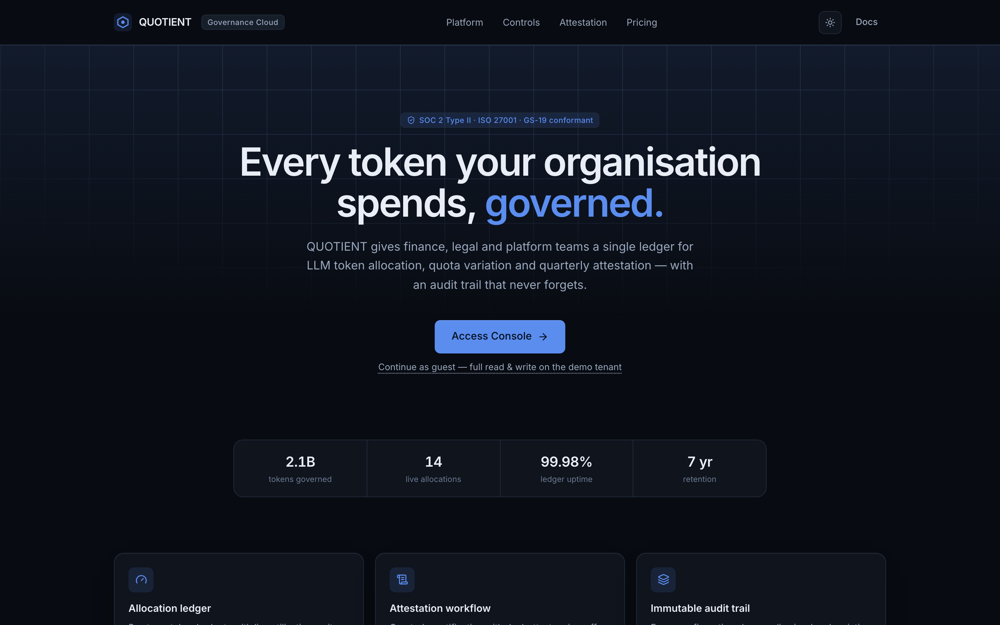
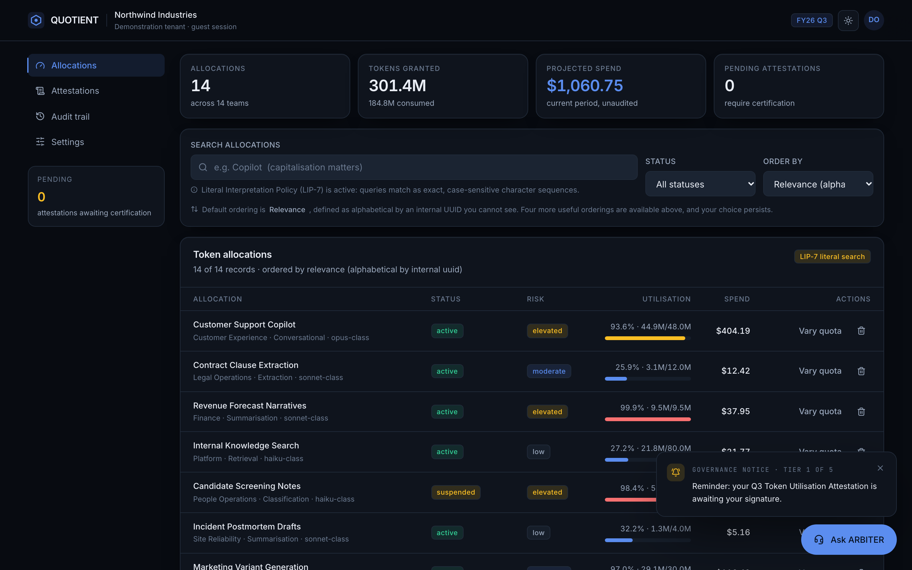
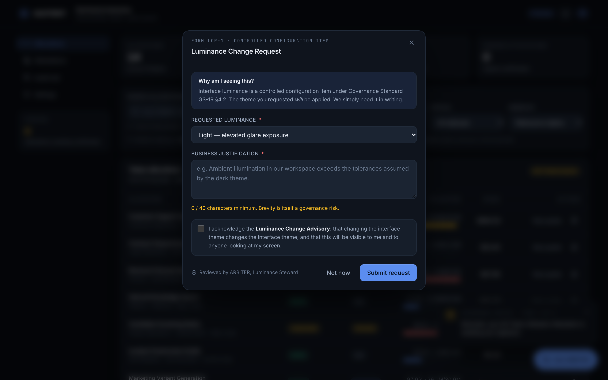
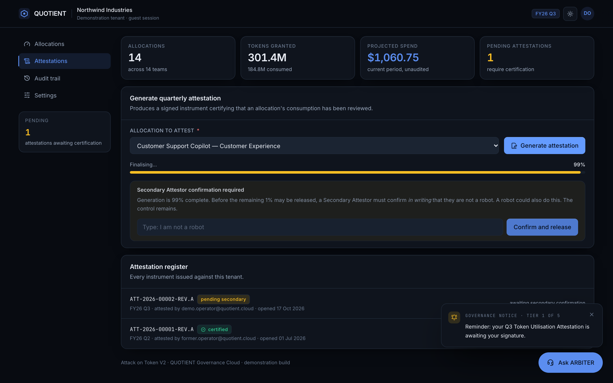
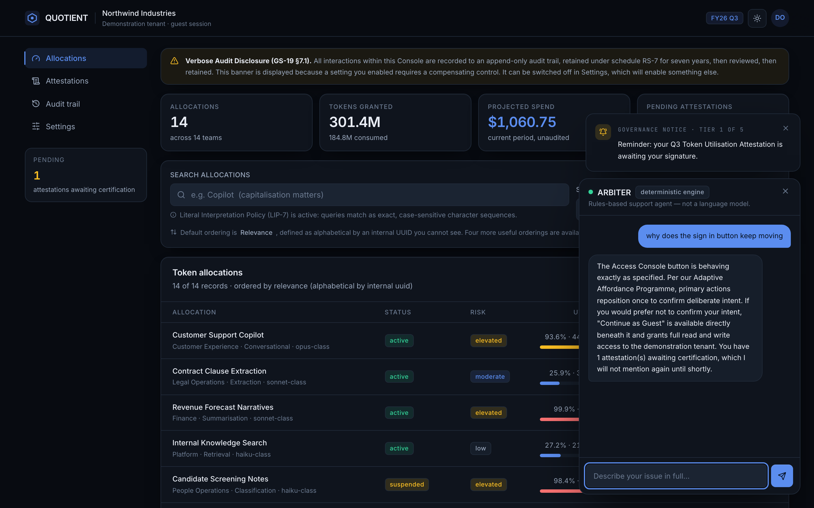
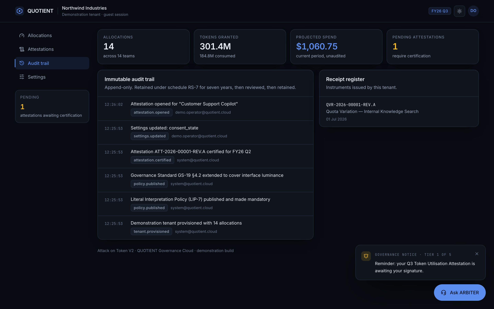
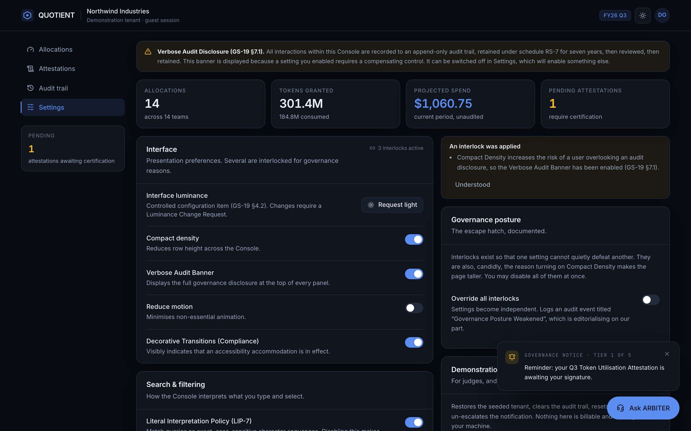

<div align="center">

# Attack on Token V2

### QUOTIENT — Enterprise Token Governance Cloud

**A full-stack SaaS platform that looks like it costs $40,000 a year and feels like a hostage negotiation.**

Every interaction is intentional, documented, recoverable and logged.
Nothing is broken. That is what makes it unbearable.



</div>

---

## 1. What this is

QUOTIENT is a fictional **LLM token governance platform** — the kind of thing a
CFO buys so that finance, legal and platform teams can argue about model spend in
one place. It has allocations, quota variations, quarterly attestations, a
receipt register and an immutable audit trail.

It is also, deliberately, one of the most infuriating pieces of software you will
ever use.

The premise: **the product is not buggy, it is governed.** Every obstruction has a
policy code, a plausible rationale and a straight face. Search returns nothing
because the Literal Interpretation Policy (LIP-7) matched your query as an exact
character sequence. The theme toggle opens a form because interface luminance is a
controlled configuration item under GS-19 §4.2. The attestation stops at 99%
because a Secondary Attestor must confirm *in writing* that they are not a robot.

> This is V2 — an independent second implementation, built from scratch. It shares
> no code with V1 and is constrained to a **strict maximum of two pages**.

### Why this concept

Scored against immediate visual credibility, breadth of available rage mechanics,
natural fit for a conversational agent, and demonstrable full-stack depth, a
governance/FinOps product won on every axis. Compliance software is the one
category where *users already expect friction*, so the parody lands instantly —
and bureaucracy generates mechanics (forms, approvals, control numbers, retention
schedules, dual sign-off) that are genuinely funny **and** genuinely full-stack.
"Attack on Token" also names the domain exactly: tokens, under attack, by process.

---

## 2. The rage engine

Ten mechanics, each mapped to a real deceptive-design category from
**Gray et al. (CHI 2018)** — Nagging, Obstruction, Sneaking, Interface
Interference, Forced Action — and **Mathur et al. (2019)**.

Every mechanic obeys four rules: **a clear trigger, a visible result, a humorous
rationale, and a working recovery path.**

| # | Mechanic | Category | What happens | How you escape |
|---|----------|----------|--------------|----------------|
| A | **Fugitive sign-in** | Interface Interference | *Access Console* slides away on click, twice, then opens a Pre-Authentication Readiness Assessment. | **Continue as guest** sits beneath it from the first paint, never moves, and grants full read/write. The assessment is skippable. |
| B | **Luminance Change Request** | Forced Action | The theme toggle opens Form LCR-1 demanding a 40-character business justification and an acknowledgement, then a four-step "review". | It always approves. The theme really changes, persists server-side, and issues a receipt. |
| C | **Literal search (LIP-7)** | Obstruction | Queries match as exact, case-sensitive character sequences. `copilot` finds nothing; `Copilot` finds the record. | The empty state explains precisely which pedantry was applied and offers **Search the way a human would**. |
| C2 | **Policy filters** | Sneaking | "Status: active" returns *every* allocation, because each one has held that status at some point within the 7-year retention window (Clause 14(b)). | **Interpret in plain English instead** — one click, persists. |
| C3 | **Worst-possible default sort** | Interface Interference | Default ordering is "Relevance", defined as alphabetical by an internal UUID you cannot see. | Four genuinely useful orderings in the same dropdown; your choice persists. |
| D | **Settings interlocks** | Interface Interference | Compact Density forces the Verbose Audit Banner on (so the page gets *taller*). Reduce Motion forces Decorative Transitions on. | Each interlock explains itself when it fires. **Override all interlocks** disables every one, permanently. |
| E | **The 99% attestation** | Forced Action | Generation climbs to 99%, then reveals that a Secondary Attestor must confirm in writing that they are not a robot. | Type `I am not a robot`. The server genuinely will not certify without it. |
| F | **Escalating notices** | Nagging | Dismissing the governance notice escalates it through five increasingly bureaucratic tiers; each dismissal is counted and quoted back at you. | From tier 3 the toast offers **File cessation request**, which permanently mutes it and persists. |
| G | **ARBITER** | — | A relentlessly polite support agent that interprets requests hyper-literally, cites invented policy codes, and knows your current panel and last action. | It does actually help, eventually, with maximum ceremony. |
| H | **Deprovisioning dialog** | Interface Interference | Three prominent buttons: *Cancel*, *Cancel (Confirm)* and *I'd rather not say*. None of them proceed. | A quiet link labelled **Proceed with deprovisioning** does, and really deletes the row. |
| I | **Consent asymmetry** | Obstruction | "Accept all" is one click. Declining takes three screens, ending with the observation that your refusal will be stored in a cookie. | It genuinely declines, persists, and never asks again. |
| J | **Bureaucratic receipts** | — | Quota variations and theme changes issue formal instruments with document control numbers (`QVR-2026-00004-REV.A`) and retention schedules. | They are real database rows, browsable in the Receipt register. |

### What this project refuses to do

No dead buttons. No endless spinners. No unrecoverable modals. No fake success
messages for failed requests. No fabricated API integrations. No real credential
collection, payments or destructive side effects. **Simulating terrible UX is the
product; compromising the user is not.** Authentication is a clearly-labelled demo
guest session — no passwords are collected or stored.

---

## 3. Screenshots

| | |
|---|---|
|  **Allocation ledger** |  **Form LCR-1** |
|  **Stuck at 99%** |  **ARBITER** |
|  **Audit trail** |  **Interlocks** |

Regenerate them any time with `npm run dev` in one terminal and
`npm run screenshots` in another.

---

## 4. Architecture

```
attack-on-token-v2/
├── server/                     Node + TypeScript API
│   ├── src/
│   │   ├── index.ts            entrypoint; seeds an empty database on boot
│   │   ├── app.ts              Express 5 routes, Zod validation, interlocks
│   │   ├── db.ts               node:sqlite schema, settings, audit log
│   │   ├── rage.ts             pure rage mechanics (search, filter, sort, nag)
│   │   ├── arbiter.ts          ARBITER: Anthropic adapter + local engine
│   │   └── seed.ts             deterministic demo tenant
│   └── test/api.test.ts        49 unit + integration tests (node:test)
├── web/                        React 19 + TypeScript + Vite
│   └── src/
│       ├── pages/              Gateway.tsx, Console.tsx  ← exactly two pages
│       ├── components/         design system + each mechanic
│       ├── store.tsx           settings, theme, nag, "last action" breadcrumb
│       └── index.css           design tokens, light/dark, a11y
├── e2e/rage.spec.ts            13 Playwright specs × desktop + mobile
├── scripts/screenshots.mjs     README screenshot capture
└── docs/DEMO.md                75-second judge script
```

**Stack.** React 19 · TypeScript (strict, `noUncheckedIndexedAccess`) · Vite 6 ·
Tailwind CSS v4 · Framer Motion · lucide-react · Express 5 · Zod ·
**`node:sqlite`** (Node's built-in driver — no native build step, no `better-sqlite3`
compile) · `node:test` · Playwright.

**Data model.** `allocations`, `attestations`, `audit_events`, `notifications`,
`settings`, `chat_messages`, `receipts` — seven tables, all of them actually used,
with CHECK constraints and foreign keys enforced in the schema rather than only in
application code.

**Two pages, as required.** `/` (Gateway) and `/console` (Console). The Console's
four panels switch via `?panel=` so they remain deep-linkable without adding routes.

**Separation of concerns.** The rage mechanics live in `server/src/rage.ts` as pure,
unit-tested functions. The UI renders their output; it does not reimplement them.
That is why "literal search" behaves identically whether you drive it from the
browser or with `curl`.

---

## 5. Prerequisites

- **Node.js ≥ 22.5** (for the built-in `node:sqlite` module). Developed on Node 26.
- npm 10+. No database server, no Docker, no cloud account.

---

## 6. Install and run

```bash
git clone https://github.com/Sree24-ui/attack-on-token-v2.git
cd attack-on-token-v2
npm install
npm run dev
```

Then open **<http://localhost:5180>**.

| Command | What it does |
|---------|--------------|
| `npm run dev` | API on `:5179` and Vite on `:5180`, concurrently. |
| `npm run seed` | Re-seed the demonstration tenant. |
| `npm test` | 49 server unit + integration tests. |
| `npm run test:e2e` | 26 Playwright runs (13 specs × desktop + mobile). |
| `npm run typecheck` | Strict TypeScript across both workspaces. |
| `npm run build` | Production frontend build. |
| `npm start` | Build the frontend, then serve API + static app from `:5179`. |
| `npm run screenshots` | Regenerate `docs/screenshots/` from the running app. |

> **First run:** the database is created and seeded automatically. There is no
> separate migration step.

### Ports

`5179` (API) and `5180` (web) are V2-specific so this can run alongside V1.

---

## 7. Configuration

Copy `.env.example` to `.env`. Every value has a working default — **the app runs
with no configuration at all.**

| Variable | Default | Purpose |
|----------|---------|---------|
| `API_PORT` | `5179` | Backend port. Deliberately *not* `PORT`: tooling frequently sets `PORT` for the frontend, and the API inheriting it causes a collision. |
| `DATABASE_PATH` | `server/data/quotient-v2.db` | SQLite file. Gitignored. |
| `ANTHROPIC_API_KEY` | *(empty)* | Optional. Enables ARBITER's live mode. |
| `ANTHROPIC_MODEL` | `claude-sonnet-5-5` | Model used in live mode. |
| `ARBITER_MODE` | `auto` | Set to `deterministic` to force the local engine. |

No secrets are committed. `.env`, `server/data/` and `*.db` are gitignored.

---

## 8. ARBITER, and an honest disclosure

ARBITER runs in one of two modes, and **the running mode is reported by
`GET /api/arbiter/health` and displayed as a badge in the chat header.**

- **`live`** — a real Anthropic model, used only when `ANTHROPIC_API_KEY` is set.
  If the call fails, it degrades to the local engine and *tells you in the UI*.
- **`deterministic`** — the default. A local intent-matching engine with 15 scored
  intents, rotating response variants, conversational depth tracking, absurd
  clarifying questions every third turn, and page/state context injection.

**In this submission ARBITER runs in deterministic mode, because no
`ANTHROPIC_API_KEY` was present in the build environment.** It is not a language
model, it does not claim to be one, and the chat header says
*"Rules-based support agent — not a language model."* Misrepresenting that would be
the one genuinely dishonest thing in an application built entirely out of honest
dishonesty.

It still holds a conversation: it tracks what you have already asked and rewords
itself rather than repeating, and it references your current panel, your allocation
count, your pending attestations and your last recorded action.

---

## 9. API

| Method | Route | Notes |
|--------|-------|-------|
| `GET` | `/api/health` · `/api/arbiter/health` | Liveness; ARBITER mode disclosure. |
| `GET` | `/api/bootstrap` | Settings, tenant summary, active notice. |
| `GET` | `/api/allocations` | `?q=&status=&sort=&search_mode=&interpretation=` |
| `POST` `PATCH` `DELETE` | `/api/allocations[/:id]` | Create (validated), quota variation (issues a receipt), deprovision. |
| `GET` `PATCH` | `/api/settings` | Interlocks applied server-side. Rejects `theme` with `403 LUMINANCE_CONTROLLED`. |
| `POST` | `/api/luminance-request` | The only route that can change the theme. |
| `GET` `POST` | `/api/attestations` | Opening one returns `progress: 99` and a blocker. |
| `POST` | `/api/attestations/:id/certify` | `422 PHRASE_MISMATCH` without the phrase. |
| `POST` | `/api/notifications/:key/dismiss` · `/mute` | Escalate; permanently silence. |
| `GET` | `/api/events` · `/api/receipts` | Audit trail; receipt register. |
| `GET` `POST` | `/api/chat[/:sessionId]` | Persisted conversation. |
| `POST` | `/api/demo/reset` | Restore the seeded tenant. |

Errors are always `{ "error": { "code", "message", "issues"? } }`. Stack traces are
never returned to the client.

---

## 10. Testing — actual verified status

All figures below were produced by running the commands on this machine
(macOS, Node 26.10.0) immediately before submission.

### `npm test` — **49 passed, 0 failed**

```
ℹ tests 49   ℹ pass 49   ℹ fail 0   ℹ duration_ms ~500
```

Covers: literal vs. human search (including case-sensitivity and the explanation
text), policy vs. plain filter interpretation, all five sort orders and
non-mutation, nag tier escalation and terminal tier, the attestor phrase matcher,
settings interlocks and the override, five ARBITER behaviours (intent routing,
non-repetition, mode disclosure, fallback ticketing), and the full HTTP surface:
validation failures, `403` on theme, the 99%→certify flow, receipt issuance,
deprovisioning, the audit trail, chat persistence, JSON 404s, **durability
(a second connection to the same file sees the writes)**, and demo reset.

### `npm run test:e2e` — **26 passed, 0 failed** (13 specs × desktop + mobile)

```
26 passed (1.6m)
```

Real Chromium, real API. Each rage-mechanic spec asserts **both** that the
infuriating behaviour happens **and** that the recovery path recovers. Also covers
layout at 1280px and 412px, state persistence across reload, and a console-error
check that fails the build on any non-HMR browser error.

### Also verified

- `npm run typecheck` — clean across both workspaces (strict mode).
- `npm run build` — succeeds; 459 KB JS / 143 KB gzipped, 34 KB CSS / 7 KB gzipped.
- Manual browser QA at 1280×800 and 375×812: no horizontal overflow
  (`scrollWidth === clientWidth === 375`), zero console errors on a clean load.

### Bugs found by this testing, and fixed

1. **The API inherited an ambient `PORT`** meant for the frontend and tried to bind
   Vite's port. Fixed by giving the API its own `API_PORT`.
2. **The Luminance receipt was wiped the instant it appeared** — approval flipped
   the theme, which flipped the modal's `target` prop, which re-ran the reset
   effect. Fixed by resetting only on the closed→open transition.

Two e2e specs also failed initially on selector precision (the responsive layout
renders desktop and mobile markup simultaneously, one CSS-hidden). Those were test
bugs and were fixed in the tests, not worked around by deleting them.

### Not run

- No cross-browser testing (Firefox/WebKit): only Chromium is installed here.
- No automated accessibility audit (axe). Keyboard focus, `aria-*` on switches,
  progressbars, dialogs and live regions, and `prefers-reduced-motion` were
  implemented and manually checked, but not machine-verified.
- No load or security testing. No deployment.

---

## 11. Known limitations

- **Single-tenant and unauthenticated by design.** The demo guest session has full
  read/write. This is a hackathon demonstration, not a multi-user product.
- **ARBITER is deterministic here** (see §8) — polished and context-aware, but not
  a language model unless you supply a key.
- **The dismissed notice returns after 9 seconds**, which is aggressive on purpose.
  Mute it from the toast or from Settings.
- **`node:sqlite` requires Node ≥ 22.5.** On older Node the server will not start.
- Theme flashes briefly on first paint, because the preference is server-persisted
  and fetched rather than read from `localStorage`.
- The frontend bundle is not code-split; at this size it does not need to be.

---

## 12. Credits

- Deceptive-design taxonomy: Gray, Kou, Battles, Hoggatt & Toombs, *"The Dark
  (Patterns) Side of UX Design"*, CHI 2018; Mathur et al., *"Dark Patterns at
  Scale"*, 2019; Harry Brignull's original pattern list (deceptive.design).
- Icons: [Lucide](https://lucide.dev) (ISC). Typefaces: Inter and JetBrains Mono
  via Google Fonts (SIL Open Font License).
- Everything else written for this project. Licensed MIT — see [LICENSE](LICENSE).

All company names, policy codes, standards (GS-19, LIP-7, RS-7, Clause 14(b),
Form 27-B) and compliance badges are fictional.

---

<div align="center">

**[→ 75-second judge demo script](docs/DEMO.md)**

*"This looks like a premium enterprise product. Why does using it make me want to throw my laptop?"*

</div>
